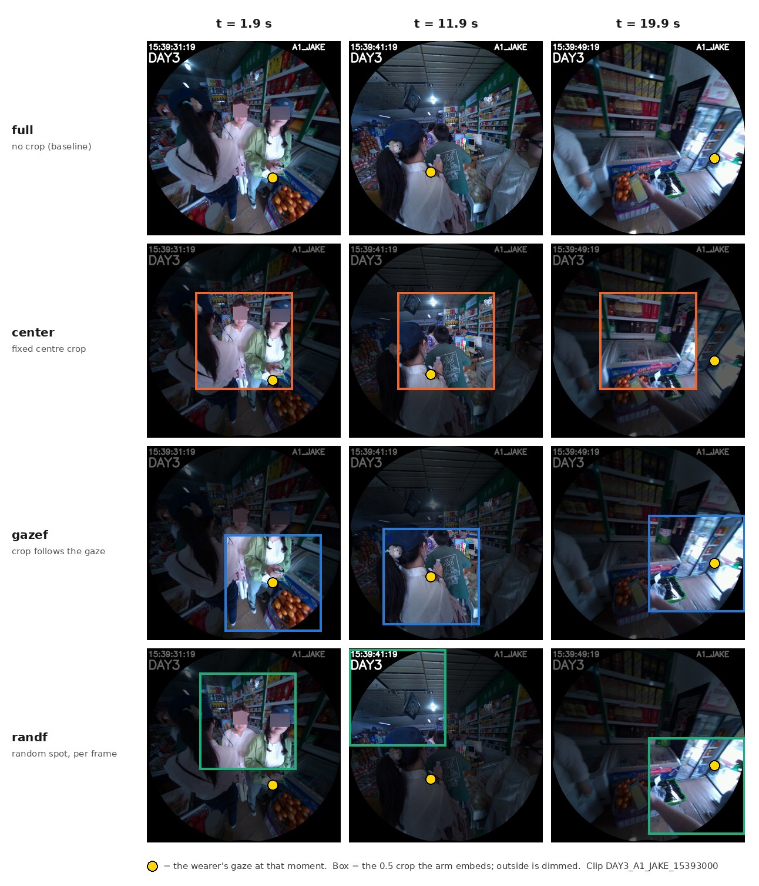
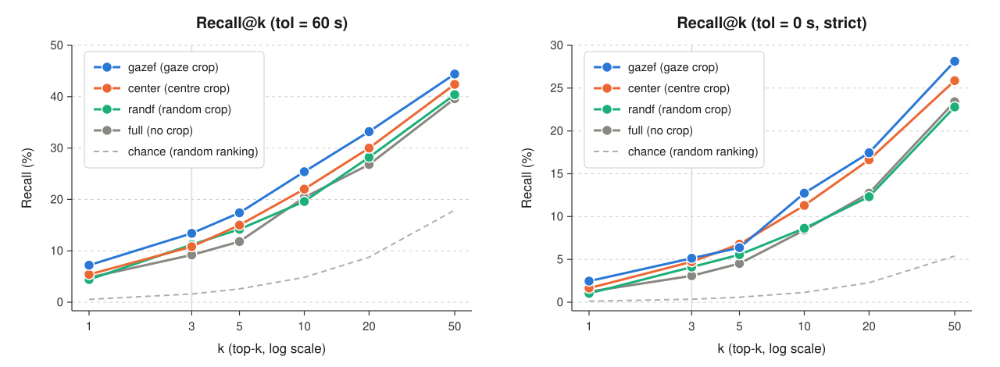
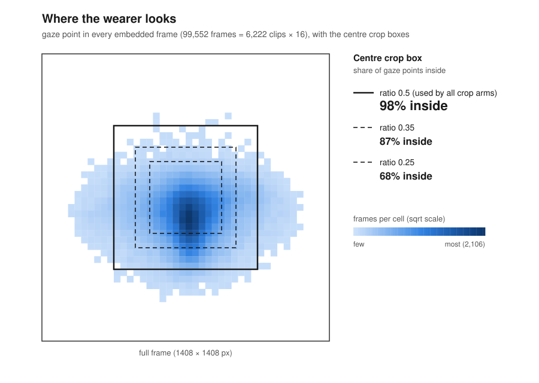
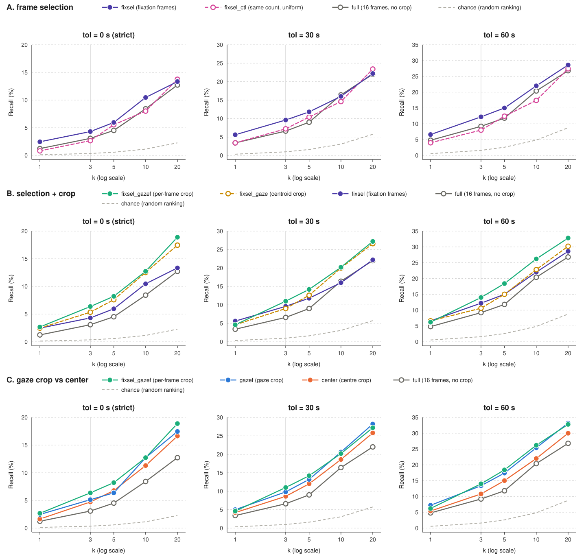
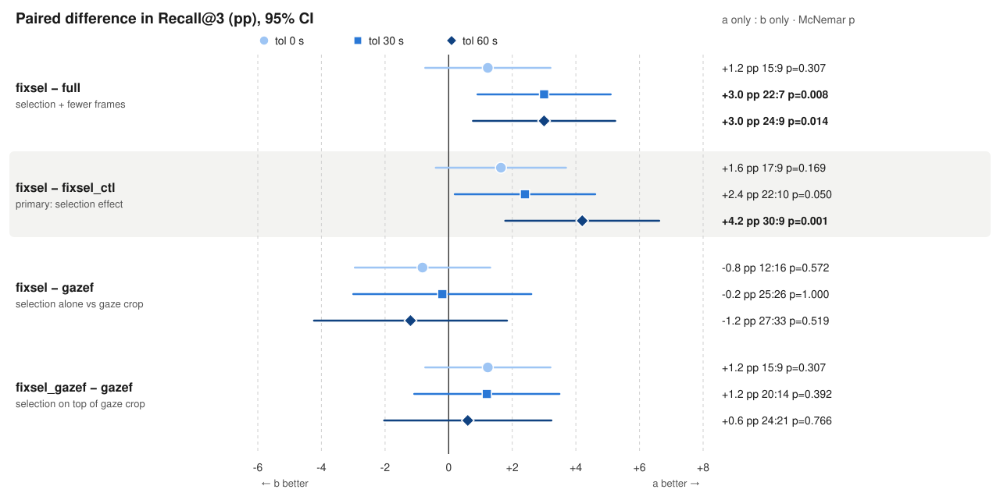
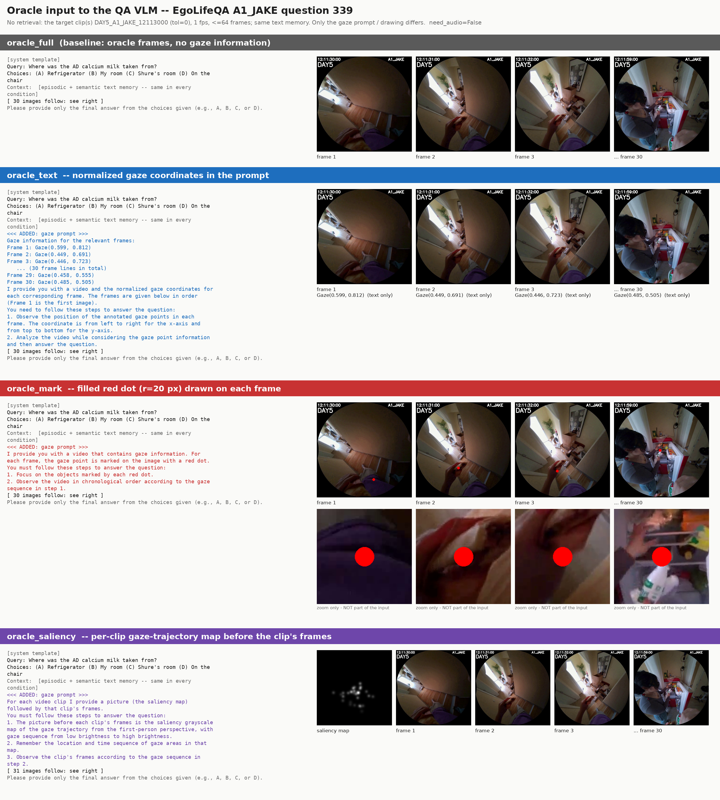
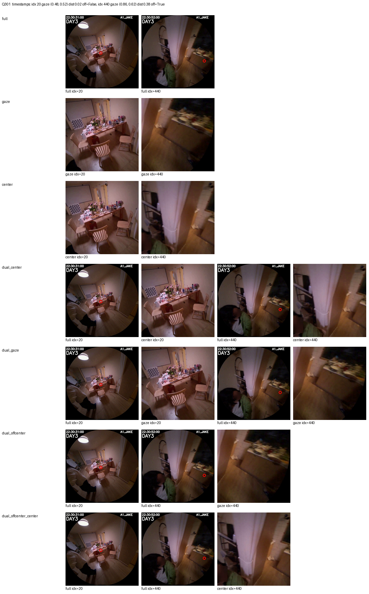
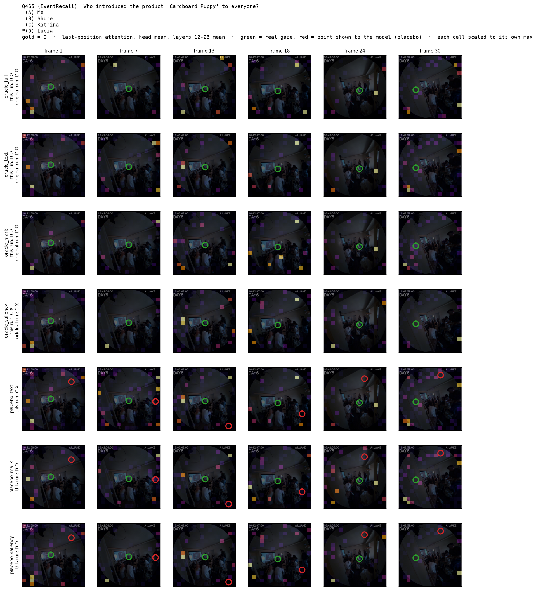

# 실험 흐름 요약: WorldMM 시각 메모리와 gaze (EgoLifeQA A1_JAKE)

> 2026-09-23 ~ 10-13에 진행한 실험들의 **결론만** 순서대로 모은 문서입니다. 각 실험은 *왜 했나 → 결과 → 해석 → 다음 실험으로*
> 순서로 적었습니다. 숫자의 원본과 세부 설계는 각 실험 폴더의 README/REPORT에 있습니다.

## 한눈에 보기

```
[1] visual_bottleneck      시각 정보는 쓸모 있는데 검색이 못 찾는다 (retrieval 병목)
        │  "시각 메모리는 가공이 부족하다" → 가장 단순한 가공부터
        ▼
[2] gaze_crop              자르기만 해도 검색 recall ↑ (9.2→13.4%). 단, 이득 대부분은 '자르기' 자체
        ├──▶ [3] egoserve_gaze_crop   다른 질의(EgoServe)에서도 같은 경향, 먼 과거 기억에서 gazef 우세
        ▼
[4] fixation_frame_selection  시선이 머문 프레임만 골라도 full보다 나음. gaze crop 위에 더하면 추가 이득 없음
        │  "검색은 좋아졌다. 그럼 QA 정답률도 오르나?"
        ▼
[5] visual_routing_qa      gaze 인덱스는 Hit@3 ↑, QA 정확도는 차이 없음. 라우터는 우연 수준
        │  "검색이 거의 실패해서 가려진 건가?" → 정답 프레임을 직접 준다
        ▼
[6] oracle gaze prompting  정답 프레임 + text/mark/saliency gaze prompting → 효과 감지 안 됨
        ▼
[7] GazeQwen               학습형 gaze 모델도 효과 없음 → 원 벤치마크에서도 gaze 위치를 안 씀 (구조적 원인 발견)
        ▼
[8] oracle_crop_qa         center bias 가설 / oracle crop → 시선 위치 효과 없음, '자르기(확대)'만 약한 이득
        ▼
[9] gaze attention 분석    (진행 중) 모델은 시선 위치를 보지 않고, 빨간 점에만 끌린다
```

**전체를 관통하는 결론**

1. WorldMM에서 시각 정보의 병목은 **검색(retrieval)** 이고, 그 원인은 시각 메모리의 **가공 부족**(클립당 벡터 1개)으로 보인다.
2. **자르기(crop)** 는 검색과 QA 모두에서 일관되게 약간의 이득을 준다. 그런데 그 이득의 대부분은 **중앙 crop으로도 얻는다.**
3. **시선 위치 자체**가 중앙보다 낫다는 증거는 검색·QA·prompting·학습형 모델 어디에서도 나오지 않았다.
   이 데이터의 시선은 화면 중앙에 몰려 있어서(시선 지점의 98%가 중앙 crop 안에 있음) 애초에 둘을 구분할 여지가 작다.
4. 정답 프레임을 줘도 QA 정확도는 약 48~50%이고, 조건에 따라 정답 여부가 바뀌는 문항은 17%뿐이다. **EgoLifeQA 정확도는 시각 입력보다 텍스트 메모리와 질문 난이도에 더 크게 좌우된다.**

---

## 1. Visual Bottleneck 진단 — [`visual_bottleneck/`](visual_bottleneck/README.md)

**왜.** WorldMM 논문에서 visual 메모리를 더했을 때 이득(E+S → E+S+V)이 작다. 원인이 (a) 정답 클립을 **못 찾아서**(retrieval)인지,
(b) 찾아 줘도 모델이 **못 써서**(utilization)인지 갈라야 고칠 곳이 정해진다.

**어떻게.** 120문항(유형별 층화), 텍스트 컨텍스트를 고정하고 visual만 바꾼 조건 비교. 답 생성은 3회 평균.

| 조건 | 정확도 (3회 평균) |
|---|---:|
| A 질문만 | 29.4% |
| B 텍스트 메모리 | 43.1% |
| D 텍스트 + **정답 클립 프레임(oracle)** | **50.3%** |
| E′ 텍스트 + **검색된** visual top-3 | 44.7% |
| E 원본 WorldMM (1회) | 41.7% |

**결과.**
- 정답 프레임을 주면 **+7.2 %p**(D−B). 텍스트 검색이 정답을 놓친 82문항에서는 **+13.0 %p (p=0.010)**. → 모델은 시각 근거를 쓸 줄 안다.
- 검색된 프레임은 **+1.7 %p**(E′−B, p=0.62). 에이전트는 visual 검색을 120문항 중 **2번**만 불렀고, 강제로 불러도 정답 클립이 top-3에 든 비율은 **5%**.
- 같은 30초 구간을 같은 방식으로 검색하면 LLM으로 가공한 **캡션은 21%**, 가공 없는 **클립 벡터는 6%** 가 정답을 찾는다.

**해석.** 병목은 **retrieval**이고(라우팅 + 검색 품질), 더 근본적인 것은 검색 품질이다. 텍스트 메모리는 번역·요약·개체/관계 추출·다중 시간 스케일·그래프를
거치는데, 시각 메모리는 30초를 **벡터 하나로 평균**할 뿐이라 질문 대상이 배경에 묻힌다.

**→ 다음.** 텍스트의 "무엇을 남길지 고르는(요약)" 단계에 대응하는 **가장 단순한 시각 가공 = 자르기**부터 효과가 있는지 본다.
1인칭 영상에는 시선(gaze)이라는 공짜 신호가 있으니 시선 주변을 자른다.

---

## 2. Gaze-crop 검색 — [`gaze_crop/`](gaze_crop/README.md)

**왜.** 픽셀만 잘라도 검색이 오르면 "시각 메모리는 가공 부족"이라는 해석이 지지된다. 시선 중심 crop이 중앙 crop보다 나으면 gaze 고유의 가치가 있다.

**어떻게.** 500문항, 6,223클립 전체에서 recall@k. 바꾸는 것은 crop 박스 하나(ratio 0.5).



| arm | 박스 | R@3 (tol=60) | R@3 (tol=0) |
|---|---|---:|---:|
| `full` | 전체 화면 | 9.2% | 3.1% |
| `center` | 중앙 고정 | 10.8% | 4.7% |
| `randf` | 프레임마다 무작위 | 11.2% | 4.1% |
| **`gazef`** | **프레임마다 시선** | **13.4%** | **5.1%** |

<picture>
  <source media="(prefers-color-scheme: dark)" srcset="gaze_crop/analysis/recall_curves_dark.svg">
  
</picture>

**결과.**
- `gazef − full` **+4.2 %p (p=0.006)**, 상대 +46%. 모델·프레임·질의는 그대로 두고 **자르기만** 했다.
- 하지만 `center`만으로 +1.6 %p를 얻고, 판정 비교 `gazef − center`는 +2.6 %p (p=0.079), 엄격 채점에서 +0.4 %p.
- 순위 전체로는 `gazef`가 `center`, `randf`를 앞서지만, 이득은 거의 **200위 아래**에서 나오고 top-10에서는 우위가 없다.
- 대화 근거 문항에서는 **움직이는 crop**(`gazef`, `randf` 모두)이 recall을 두 배 이상 올렸다(4.5% → 10.9%).

<picture>
  <source media="(prefers-color-scheme: dark)" srcset="gaze_crop/analysis/gaze_heatmap_dark.svg">
  
</picture>

**해석.**
- 시각 메모리는 **가공 부족 상태가 맞다**. 가장 단순한 처리로도 recall이 오른다.
- 이득의 큰 몫은 **자르기 자체**다. 시선 지점의 **98%가 중앙 crop 박스 안**에 있고 두 박스의 IoU 중앙값이 0.60이라,
  ratio 0.5에서는 `gazef`와 `center`가 거의 같은 픽셀을 본다. "시선이 소용없다"가 아니라 **"개입이 작아서 구분이 안 된다"** 로 읽어야 한다.
- 균등 16프레임 중 상당수는 시선이 이동 중(saccade)이라 그 순간의 시선은 아무것도 "보고" 있지 않다.
- 방법론: 120문항에서 안 보이던 효과가 500문항에서 p=0.006이 됐다. 그리고 visual_bottleneck의 120문항은 유난히 검색이 어려운 subset이었다(`full` R@3 0.8% vs 나머지 11.8%).

**→ 다음.** (a) 다른 질의 형식에서도 같은지 확인(3), (b) "어디를 자를지" 대신 **"어느 순간을 쓸지"** 를 시선으로 고른다(4).

---

## 3. EgoServe 질의로 확인 — [`egoserve_gaze_crop/`](egoserve_gaze_crop/README.md) (곁가지)

**왜.** 같은 영상·gaze에 주석만 다른 EgoServe(proactive 이벤트)로 바꿔도 crop의 이득이 유지되는지 본다. 임베딩은 gaze_crop의 것을 그대로 쓰고 질의·정답만 새로 만들었다.

**결과.** 88개 질의 전체로는 조건 간 차이를 말하기 어렵다. **10분 이상 전 / 다른 날의 기억(`long_ago`, 32개)** 에서는 `gazef`가 `full`보다
정답 순위가 일관되게 좋았다(22:9 ~ 26:5, p=0.002~0.01). 하지만 `center`도 비슷하게 나아서 시선 덕인지 자르기 덕인지는 가르지 못했다.

**해석.** gaze_crop과 같은 그림이다: **crop은 돕고, 시선과 중앙은 구분되지 않는다.** 질의를 정답 장면 묘사로 고정한 상한선 측정이라는 한계가 있다.

---

## 4. Fixation 프레임 선택 — [`fixation_frame_selection/`](fixation_frame_selection/README.md)

**왜.** gaze_crop의 두 아쉬움(① 프레임마다 시선 샘플 1개만 써서 saccade 중이면 엉뚱한 곳을 자름, ② 프레임을 시선과 무관하게 균등 추출)을 겨냥한다.
**시선이 머문 순간(fixation)의 프레임만 임베딩**하면 "주목한 장면"이 벡터에 들어갈 것이다.

**어떻게.** StreamGaze의 I-DT 검출기를 10 Hz 데이터에 맞게 고쳐 사용(원본은 이 데이터에서 fixation이 끝나지 않아 클립 전체가 1개로 잡힘).
16프레임 중 **74%가 fixation 안**. 같은 개수의 균등 프레임 대조군(`fixsel_ctl`)을 둬서 "프레임이 줄어서"를 분리했다.

<picture>
  <source media="(prefers-color-scheme: dark)" srcset="fixation_frame_selection/analysis/figures/recall_at_k_curves_dark.svg">
  
</picture>

| arm | R@3 tol0 | R@3 tol30 | R@3 tol60 |
|---|---:|---:|---:|
| `full` | 3.1% | 6.6% | 9.2% |
| `fixsel_ctl` (개수 통제) | 2.7% | 7.2% | 8.0% |
| `fixsel` (fixation 프레임만) | 4.3% | 9.6% | 12.2% |
| `gazef_05` | 5.1% | 9.8% | 13.4% |
| **`fixsel_gazef_05`** (선택 + gaze crop) | **6.4%** | **11.0%** | **14.0%** |

<picture>
  <source media="(prefers-color-scheme: dark)" srcset="fixation_frame_selection/analysis/figures/paired_diff_recall_at_3_dark.svg">
  
</picture>

**결과.**
- **프레임 선택만으로** `full` 대비 +1.2 / +3.0 / +3.0 %p. 개수 통제군은 `full`과 구분되지 않아 **고른 프레임이 좋아서**다.
- 하지만 사전에 정한 주 결과(tol 0, `fixsel − fixsel_ctl`)는 +1.6 %p, **p=0.17로 유의하지 않다.** tol 60에서만 뚜렷(+4.2 %p, p=0.001).
- `fixsel_gazef`가 R@3 1위지만 **`gazef`와의 차이는 모든 k·tol에서 신뢰구간이 0을 포함**한다.
- `fixsel` vs `gazef`: top-3는 비슷하고, 순위 전체로는 crop(`gazef`)이 낫다.
- 질의를 QA 키워드로 바꿔도 결론은 같았다.

**해석.** 선택은 top 근처의 몇 문항을, crop은 순위 전체를 끌어올린다. 둘을 합쳐도 추가 이득이 없는 것은 **중복**(선택이 빼는 잡음을 crop이 이미 빼고 있음)으로 보인다.
그리고 이번에도 **시선 위치가 중앙 crop보다 낫다는 증거는 없다.**

**→ 다음.** 검색 쪽에서 crop의 이득은 확인됐다. 이제 **QA 정확도까지 이어지는지**, 그리고 full과 gaze가 서로 다른 문항을 맞힌다면 **문항별로 골라 쓰면(라우팅)** 이득이 나는지 본다.

---

## 5. Full / Gaze / Routing QA — [`visual_routing_qa/REPORT.md`](visual_routing_qa/REPORT.md)

**왜.** (1) gaze crop이 검색 + QA 입력으로 더 좋은가, (2) 질문마다 유리한 쪽이 다르다면 라우터로 둘의 장점을 합칠 수 있는가.

**어떻게.** 500문항, 텍스트 메모리 고정, visual top-3 검색을 모든 문항에 강제. A `full`, B `gaze`, C 라우터(Qwen3-VL이 두 arm의 증거 프레임을 비교, 순서를 바꿔 두 번 묻고 일치할 때만 채택),
D/E는 full과 gaze를 함께 보여 주는 dual-view.

| 지표 | full | gaze | routing | oracle (A OR B) |
|---|---:|---:|---:|---:|
| QA 정확도 | 44.0% | **45.0%** | 43.8% | 49.4% |
| Hit@3 (tol=0) | 4.3% | **7.2%** | 5.5% | 9.0% |
| Hit@3 (tol=60) | 10.8% | **15.8%** | 13.0% | 19.4% |

**결과.**
- 검색: gaze가 Hit@3 **+2.9 / +5.0 %p로 유의하게** 높다.
- QA: gaze +1.0 %p, CI [−1.8, +3.6] → **차이 없음.**
- 라우터: 두 arm의 정오가 갈리는 문항에서 맞는 쪽을 고른 비율 **43~48% (우연 이하)**. 순서 불일치 35% → FULL fallback이라 결국 routing ≈ full.
- oracle(둘 중 하나라도 맞으면)은 +5.6 %p로 **상보성은 있지만** 지금 라우터로는 못 쓴다.
- dual-view: D = gaze와 동일(45.0%), E 43.6%. 이미지를 합쳐도 도움이 안 된다.

**해석.** 검색 개선은 확실하지만 절대 수준(Hit@3 4~16%)이 너무 낮아 대부분의 문항에서 시각 정보가 정답 장면을 담지 못한다. 그래서 QA로 이어지지 않는다.

**→ 다음.** "gaze가 QA에 안 듣는 것인가, 검색 실패에 가려진 것인가"를 가르기 위해 **정답 클립 프레임을 직접 주는(oracle) 설정**으로 간다.
그리고 crop 대신, gaze를 MLLM에 직접 알려주는 기존 방법(EgoGazeVQA의 gaze prompting)을 적용한다.

---

## 6. Oracle 프레임 + gaze prompting — [`visual_routing_qa/ORACLE_REPORT.md`](visual_routing_qa/ORACLE_REPORT.md)

**왜.** 검색 프레임 위에서 gaze prompting 3종은 모두 `full`과 구분되지 않았다(−0.4 ~ −1.4 %p). 검색 실패를 제거하면 효과가 드러나는지 본다.

**어떻게.** 정답 클립이 정해지는 487문항, 정답 클립의 1 fps 프레임. EgoGazeVQA-Plus 방식 그대로:
`text`(좌표를 텍스트로), `mark`(빨간 점), `saliency`(시선 궤적 맵).



| 조건 | 정확도 | `oracle_full` 대비 | 95% CI |
|---|---:|---:|---|
| `oracle_full` | 48.3% | – | – |
| `oracle_text` | 48.9% | +0.6 | [−1.8, +3.3] |
| `oracle_mark` | 48.5% | +0.2 | [−2.3, +2.7] |
| `oracle_saliency` | 50.1% | +1.8 | [−0.8, +4.5] |
| (참고) 검색 `full` | 44.1% | | |

**결과.**
- 정답 프레임 자체는 도움이 된다: `oracle_full − 검색 full` **+4.1 %p (p=0.019)**.
- gaze prompting은 **효과 감지 안 됨.** 세 방식 평균 +0.9 %p [−1.4, +3.2], p=0.48. 시각 근거 문항만 봐도 같다.
- 세 방식이 모두 양수인 것은 독립적인 증거가 아니다(같은 기준선, 문항 변화 상관 0.63~0.68).

**해석.** **+5 %p 이상의 큰 효과는 배제**된다. 즉 이전 null은 검색 실패 때문만이 아니었다. +1~2 %p 수준은 이 표본(±2.5 %p 해상도)으로 알 수 없고,
있더라도 gaze **내용** 덕인지 **프롬프트 형식** 덕인지 구분하지 못했다(위약 대조 없음).

**→ 다음.** 프롬프트 방식이 아니라 **gaze를 학습으로 주입하는 모델(GazeQwen)** 은 다를까? 위약(placebo, 위치만 무작위) 대조를 포함해 본다.

---

## 7. GazeQwen — [`visual_routing_qa/GAZE_PROMPTING_REPORT.md`](visual_routing_qa/GAZE_PROMPTING_REPORT.md)

**왜.** GazeQwen(Qwen2.5-VL-7B + V-JEPA 특징 + GazeLens + LoRA)은 fixation 좌표를 LLM 내부 영상 토큰에 주입한다. 학습형이니 gaze를 더 잘 쓸 수 있다.

**어떻게.** 구성 요소를 하나씩 더한 5조건(`q25_full` → `lora_only` → `inject_only` → `gaze`, 그리고 위치만 무작위인 `placebo`). 이식하며 transformers 4.57 호환 문제(레이어 경로, **LoRA가 한 번도 적용되지 않던 버그**)를 고쳤다.

**결과 (EgoLife, N=487).**

| 비교 | Δ %p | 개선/악화 |
|---|---:|---:|
| LoRA (`lora_only − q25_full`) | −3.3 | 43 / 59 |
| gaze 내용 (`gaze − inject_only`) | +0.4 | 5 / 3 |
| gaze 위치 (`gaze − placebo`) | +0.6 | 3 / 0 |

- gaze를 바꿔도 답이 바뀐 문항은 fixation이 있는 396문항 중 **3개**. 반면 attention 구현(sdpa ↔ eager)만 바꿔도 **답의 25~33%가 바뀐다.**

**이식 문제인지 확인: 원 벤치마크(StreamGaze test, 2,140샘플).**

| 조건 | 정확도 |
|---|---:|
| 원본 Qwen2.5-VL (README) | 50.4% |
| `lora_only` | 68.8% |
| `placebo` (위치 무작위) | 69.4% |
| GazeQwen 재현 (`gaze`) | 69.3% (README 70.3%) |

- 재현은 됐다. 그런데 **실제 gaze와 무작위 위치의 답은 2,140개 중 4개만 달랐다.** README의 +20 %p 중 약 +18 %p는 **LoRA만으로** 나오고, 일부는 정답 분포 쏠림(예: OAA "항상 Yes" 72.5%)으로 설명된다.

**원인 (코드로 확인).**
1. **입력 설정**: 학습 시 프레임 2장 = 시간 스텝 1개라, gaze 좌표가 실제로 들어간 학습 샘플이 약 **6%**.
2. **GazeLens 구조**: 응시점을 256차원 벡터 하나로 인코딩해 **729개 영상 토큰의 key에 같은 값으로** 더한다. 모든 칸에 같은 상수라 softmax에서 상쇄된다 → **구조상 응시 위치를 반영할 수 없다.**


**해석.** EgoLife에서의 null은 이식 오류가 아니라 **공개 체크포인트의 성질**이다. gaze를 실제로 쓰는 모델이 필요하면 칸마다 다른 gaze bias를 주도록 GazeLens를 바꿔 다시 학습해야 한다.
측정하려는 효과가 시스템의 수치 노이즈(구현 차이)보다 훨씬 작다는 점도 중요한 교훈이다.

**→ 다음.** gaze를 "알려주는" 방식은 모두 효과가 없었다. 다시 **crop(입력 자체를 바꾸기)** 으로 돌아가, oracle 프레임에서
(a) EgoEverything에서 관찰된 "시선에서 먼 객체가 어렵다"가 **VLM의 center bias** 때문인지, (b) crop이 QA에 도움이 되는지 본다.

---

## 8. Oracle 프레임 crop QA — [`oracle_crop_qa/`](oracle_crop_qa/README.md)

**왜.** 시선이 중앙에서 벗어난 순간에 그 영역을 **중앙으로 옮긴 crop**을 덧붙여 정확도가 오르면 center bias 가설이 지지된다.
같은 파이프라인으로 gaze crop vs center crop도 QA에서 직접 비교한다.



| 조건 | 정확도 (N=487) | 시각 근거 문항 (N=287) |
|---|---:|---:|
| `full` | 48.0% | 48.1% |
| `gaze` | 49.7% | 52.3% (+4.2, p=0.043) |
| `center` | **51.1%** (+3.1, p=0.032) | **53.3%** (+5.2, p=0.006) |
| `dual_gaze` / `dual_center` | 50.3% / 50.5% | 50.5% / 50.5% |
| `dual_offcenter` | 48.7% | 48.8% |
| `dual_offcenter_center` (대조) | 48.5% | 47.7% |

**결과.**
- **Center bias:** `dual_offcenter − full` +0.6 %p, 대조군과의 차이 +0.2 %p → 지지 증거 없음. 다만 off-center 프레임이 8.3%뿐이라 **검정력이 약한 검증**이다.
- **gaze vs center:** `gaze − center` −1.4 %p, `dual_gaze − dual_center` −0.2 %p (Holm p ≥ 0.84). 시선 위치의 이득 없음.
- **자르기 자체**는 약한 이득(부 비교, 보정 없음). 전체 프레임을 함께 주면 crop만 줄 때보다 낫지 않다.
- 조건에 따라 정답 여부가 바뀐 문항은 **84개(17%)** 뿐. 거의 같은 입력(gaze vs center crop, IoU 0.60)에도 60문항에서 답이 달라진다.

**해석.** crop의 이득은 QA 모델이 이미지를 512 px로 줄이기 때문에 생기는 **확대(약 2배 해상도) + 어안 검은 테두리 제거**로 설명하는 편이 맞는다
(시간과 무관한 시각 근거 문항에 이득이 몰림). 검색 실험에서 `center`가 `gazef` 이득의 대부분을 가져간 것과 같은 방향이다.
3~5 %p 차이는 입력 변화에 대한 모델의 민감도 안에 묻힐 수 있다.

**→ 다음.** 성능 숫자로는 더 가를 수 없으니, **모델이 실제로 어디를 보는지**(attention)를 직접 본다.

---

## 9. (진행 중) Gaze prompting 시 모델의 attention — `visual_routing_qa/gaze_attention.py`

> 아직 README로 정리하지 않은 예비 결과입니다. `run_data/gaze_attention_prompt68/summary.txt` 기준.

**왜.** 6에서 gaze prompting이 답을 바꾼 문항들이 있었다. 이게 모델이 **시선 위치를 실제로 더 봐서**인지, 형식이 바뀌어서인지 attention으로 확인한다.

**어떻게.** 6의 프롬프트 조건 + 각각의 위약(같은 형식, 점 위치만 ≥0.25 떨어진 무작위). 정답 글자를 예측하는 마지막 위치의 attention을 프레임별 토큰 격자로 저장.
68문항, concentration = 시선 반경(0.1) 안의 attention 비율 ÷ 면적 비율 (1 = 균일).



**예비 관찰.**
- 기준선(`oracle_full`)에서 실제 시선 주변의 concentration은 **0.2~0.5**로 균일보다 낮다. 모델은 착용자가 본 곳을 특별히 보지 않는다
  (예시 그림에서도 attention이 화면 가장자리·테두리·오버레이 쪽에 흩어져 있음).
- `text`, `saliency`: 실제 시선 위치의 attention이 **변하지 않는다**(×0.98~1.03, late layer saliency만 ×1.16).
- `mark`: 빨간 점 위치의 attention이 **약 2배**(middle ×2.2). 그런데 위약 점에도 ×1.4~1.7로 끌린다 → **시선 내용이 아니라 빨간 점이라는 시각 표식**을 본다.
- `mark`가 attention을 끌어올린 정도는 답이 고쳐진 문항(×2.40)과 망가진 문항(×2.54)에서 같다 → attention 이동이 **정답으로 이어지지 않는다.**

**잠정 해석.** gaze prompting이 효과가 없던 이유와 일관된다: 텍스트·saliency로 준 시선은 모델의 시각 attention을 움직이지 못하고, 마크는 움직이지만 그 위치가 답과 무관하다.

---

## 남은 질문과 후보 실험

| 질문 | 후보 실험 | 출처 |
|---|---|---|
| 시선 위치가 중앙보다 나은가? (ratio 0.5에서는 구분 불가) | 작은 ratio(0.25~0.35) + 같은 ratio의 center | gaze_crop 5.2, oracle_crop_qa 9 |
| 프레임 선택 효과가 개수 교란 없이도 남는가? | `SELECT=refill` (16장 고정) | fixation 5.2 |
| 클립당 벡터 1개가 정보를 뭉개는가? | fixation 구간별 sub-vector + max 점수 | gaze_crop 5.3 |
| 개선이 gaze 내용 덕인가 형식 덕인가? (prompting) | text/mark/saliency 위약 대조 (attention 분석으로 일부 진행) | ORACLE_REPORT 9 |
| center bias가 실제로 있는가? | 확대 없는 재중심화, 객체 위치가 주석된 데이터에서 직접 검증 | oracle_crop_qa 9 |
| crop 이득은 확대/테두리/오버레이 중 무엇인가? | `full_nooverlay`, 픽셀 수준 미세 변형으로 민감도 측정 | oracle_crop_qa 9 |
| gaze를 실제로 쓰는 학습형 모델 | 칸마다 다른 gaze bias(가우시안 가중 등)로 GazeLens 수정 후 재학습 | GAZE_PROMPTING 4.6 |
| 시각 메모리 구조화의 다음 단계 | 사람·물체 단위 시각 표현, 텍스트 그래프와 연결 | visual_bottleneck 4 |

## 공통 한계

- 피험자 1명(A1_JAKE), 응답 모델은 주로 Qwen3-VL-8B 하나, 문항 약 500개. QA에서 약 ±2.5 %p 이내의 효과는 구분할 수 없다.
- 시선 좌표는 캘리브레이션 없이 단일 focal로 투영한 근사값이고, 머리 기준 각도다.
- 여러 tol·비교에 대해 대부분 다중비교 보정을 하지 않았다. 사후 분할 결과는 가설 생성용으로만 읽는다.
