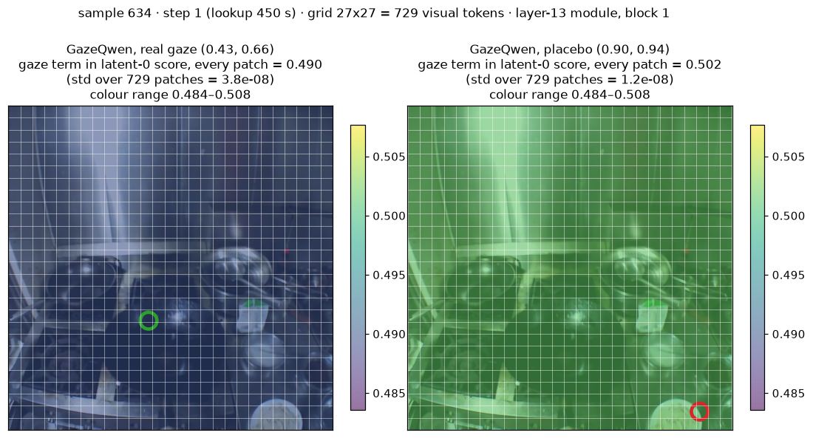
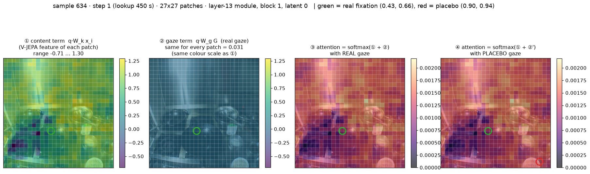

# EgoLifeQA에서 gaze를 쓰는 네 가지 방식 비교 (WorldMM, A1_JAKE, oracle 프레임)

> **한 줄 요약.** gaze를 MLLM에 알려주는 네 가지 방식(text, mark, saliency, GazeQwen)을 EgoLifeQA 487문항에 적용했지만, **어느 방식도 gaze 때문에 정확도가 좋아졌다는 증거를 얻지 못했다.**
> 프롬프트 방식 세 가지는 `oracle_full` 대비 +0.2 ~ +1.8 %p(모두 신뢰구간이 0을 포함), GazeQwen은 gaze를 넣은 쪽이 gaze 없는 쪽보다 +0.4 %p, 위치를 무작위로 바꾼 쪽보다 +0.6 %p(역시 0을 포함)였다.
>
> - 이것은 "gaze가 소용없다"가 아니라 **"이 실험이 감지할 수 있는 크기의 효과는 없었다"**이다. 이 표본(N=487)은 약 ±2.5 %p 이내의 효과를 구분하지 못한다.
> - GazeQwen에서는 gaze를 바꿔도 **답이 거의 바뀌지 않았다**(fixation이 있는 396문항 중 3문항). 구현(sdpa/eager)을 바꾸는 것만으로 **답의 25~33%가 바뀌었는데**, 이 구현 차이가 gaze 효과보다 훨씬 크다.
> - **이식 실패가 아니다(4장).** 원 벤치마크(StreamGaze test, 2,140샘플)에서 GazeQwen을 재현했고(69.3%, README 70.3%), 같은 자리에서 **실제 gaze와 위치를 무작위로 바꾼 gaze의 답은 4개만 달랐다.** README가 보고한 +20 %p 중 약 +18 %p는 LoRA만으로 나온다. 즉 공개 체크포인트는 원 벤치마크에서도 gaze 위치를 거의 쓰지 않으며, EgoLife의 null 결과는 예상된 결과다. 원인은 두 겹이다: 학습 입력이 프레임 2장(시간 스텝 1개)이라 gaze 좌표가 들어간 학습 샘플이 약 6%이고(4.4), GazeLens가 응시점 인코딩을 모든 영상 토큰의 key에 같은 값으로 더해 softmax에서 상쇄되므로 **구조상 응시 위치를 반영할 수 없다**(4.5).

관련 문서: [ORACLE_REPORT.md](ORACLE_REPORT.md)(text/mark/saliency 상세), [README.md](README.md), [REPORT.md](REPORT.md).

---

## 1. 왜 이 실험을 했나

gaze를 MLLM의 입력으로 쓰는 방법은 지금까지 **EgoGazeVQA**(In the Eye of MLLM, NeurIPS 2025)와 **StreamGaze**에서만 평가됐다. 두 벤치마크의 질문은 "무엇을 보고 있는가, 왜 보는가"처럼 시선 자체를 묻는 것이 많다.
이 실험은 **gaze prompting이 EgoLifeQA에서도 효과가 있는지** 본다. EgoLifeQA는 며칠에 걸친 일상 영상에서 사건·개체·관계를 묻는 문항이라, 시선 위치가 답과 직접 닿지 않을 수 있다. 효과가 있다면 gaze가 질문 유형에 상관없이 쓸모 있다는 뜻이고, 없다면 gaze의 쓸모가 시선을 묻는 질문에 한정된다는 단서가 된다.

검색된 클립에서는 정답 장면이 거의 들어 있지 않아(hit@3 10.8%) 효과가 가려질 수 있었다. 그래서 **정답 클립 프레임을 직접 주는 oracle 설정**으로 검색 실패를 제거했다.

## 2. 실험 구현

### 2.1 공통 설정
- 대상: 정답 클립(`tol=0`)이 정해지는 **487문항**(EgoLifeQA A1_JAKE, 13문항은 정답 시점이 클립 사이 틈에 있어 제외).
- 프레임: 정답 클립(들)의 1 fps 프레임, 클립별 비례 샘플링으로 최대 64장.
- 텍스트 메모리: `run_data/text_context/`의 미리 검색된 항목을 **모든 조건에 동일하게** 사용(해시 검증).
- 채점: 선택지 4개 중 정답 일치.

### 2.2 EgoGazeVQA-Plus의 gaze prompting 세 가지 ([oracle.py](oracle.py))
EgoGazeVQA-Plus의 `test_tool` 코드를 그대로 옮겼다. QA 모델은 **Qwen3-VL-8B**(greedy).

| 조건 | gaze를 전달하는 방식 |
|---|---|
| `oracle_full` | gaze 정보 없음(기준선) |
| `oracle_text` | 프레임 앞에 정규화 좌표 블록(`Frame i: Gaze(0.412, 0.667)`) + 단계 지시문 |
| `oracle_mark` | 각 프레임의 gaze 위치에 채워진 빨간 점(반지름 20 px) + 지시문 |
| `oracle_saliency` | 클립마다 회색조 gaze 궤적 맵 1장(σ=20, 반경 60)을 그 클립 프레임 앞에 둠 |

픽셀 상수는 레퍼런스 값 그대로(EgoLife 1408 px에 맞춰 재조정하지 않음). 자세한 차이는 ORACLE_REPORT 3장.

### 2.3 GazeQwen ([oracle_gazeqwen.py](oracle_gazeqwen.py))
GazeQwen 저장소([phamtrongthang/gazeqwen](https://huggingface.co/phamtrongthang/gazeqwen))의 코드와 체크포인트(`best_model.pt`, V-JEPA 2.1 ViT-B)를 그대로 사용했다.

**모델.** Qwen2.5-VL-7B(고정) + V-JEPA 2.1 특징 + GazeLens(perceiver, 약 10.8M) + LoRA(rank 8, LLM의 q/v). fixation 좌표의 cosine 위치 인코딩이 LLM 레이어 [6, 13, 20, 27]의 **비디오 토큰 hidden state에 residual로 더해진다.** 입력 프롬프트는 바뀌지 않는다.

**입력(설정 A).** 기존 oracle과 같은 입력 구성이다. `Query/Choices` → `Context`(텍스트 메모리) → **oracle 프레임을 비디오 하나로**(긴 변 448 px, 최대 64장 → 시간 스텝 최대 32) → "A, B, C, D 중 하나만 답하라". 비디오로 넣는 이유는 GazeQwen의 hook이 비디오 토큰 블록에 주입하기 때문이다. `second_per_grid_ts=2.0`(1 fps)으로 학습 조건과 맞췄다. 정답 클립이 여러 개면 이어 붙여 하나의 비디오로 만들고, fixation 시각을 비디오 시간축(k번째 프레임 = k초)으로 옮겼다.

**답 읽기.** 첫 답 토큰에서 A/B/C/D의 logit 중 최대. 마지막 `lm_head` 입력을 잡아 **fp32로 계산**한다(bf16 logit은 0.06~0.125 단위로 양자화되어 작은 효과가 가려졌다).

**fixation 생성.** GazeQwen 저장소에는 fixation을 만드는 코드가 없고 학습에는 StreamGaze 전처리 결과(`*_fixation_filtered.csv`, step 1.5의 출력)를 쓴다. StreamGaze 검출기는 약 30 Hz 데이터를 전제로 짧은 이탈을 샘플 간격으로 판정하는데, EgoLife gaze는 균일한 10 Hz라 그대로 쓰면 fixation이 끝나지 않고 클립 전체가 하나로 잡힌다. 그래서 10 Hz용으로 고친 수정판(`fixation_frame_selection/streamgaze`, 이탈 시간을 이탈 시작부터 측정·dropout 처리 추가; 상세는 `fixation_frame_selection/README.md` 2.2)을 반경 0.05, gap 0.2 s, dropout 0.4 s로 쓰고, step 1.5의 **지속시간 ≥ 2.5 s** 필터를 적용했다. step 1.5의 장면 일관성(히스토그램)·검은 화면 필터는 적용하지 않았다. 이 기준에서 정답 클립 447개 중 81%가 fixation을 1개 이상 갖고(클립당 평균 1.73개), 문항 단위로는 **487개 중 396개(81%)**가 fixation이 있다.

> **정정(4.1).** 이후 확인해 보니 GazeQwen이 쓰는 `*_fixation_filtered.csv`는 이름과 달리 step 1.5의 출력이 아니라 **step 1 출력 전체**(StreamGaze 검출기: 반경 0.088~0.15, 최소 2 s, gap 0.01 s; 2.5 s 필터·장면 필터 없음)다. 따라서 위 EgoLife fixation은 학습 분포보다 훨씬 적다. 다만 4장에서 보듯 GazeQwen은 원 벤치마크에서도 gaze 위치를 쓰지 않으므로 이 차이가 결과를 바꿀 가능성은 낮다.

**조건 5개.** 구성 요소를 하나씩 더해서 각각의 기여를 분리한다.

| 조건 | 모델 | V-JEPA 주입 | scanpath |
|---|---|---|---|
| `gq_q25_full` | 원본 Qwen2.5-VL | 없음 | 없음 |
| `gq_lora_only` | + LoRA | 없음 (hook 설치, 비활성) | 없음 |
| `gq_inject_only` | + LoRA | 있음 | 한 시간대에도 활성이 아닌 더미 fixation 1개 |
| **`gq_gaze`** | + LoRA | 있음 | 실제 fixation |
| `gq_placebo` | + LoRA | 있음 | 실제와 같은 시각·지속시간, **중심만 무작위**(실제 위치에서 ≥0.25 떨어진 곳) |

- `gaze − inject_only`: scanpath 내용의 효과, `gaze − placebo`: 위치의 효과, `inject_only − lora_only`: V-JEPA 주입의 효과, `lora_only − q25_full`: LoRA의 효과.
- 빈 scanpath는 GazeLens가 0 residual을 돌려주므로 `lora_only`와 같다. 그래서 `inject_only`는 일부러 "활성 아닌 fixation"으로 만들었다. fixation이 없는 91문항에서는 `gaze`가 구조적으로 `lora_only`와 같다.

**이식 중 고친 것(결과 해석에 영향).** 사용한 transformers 4.57은 GazeQwen이 전제한 구조와 다르다. ① LLM 레이어 경로가 `model.language_model.layers`로 바뀌어 hook 설치가 실패했고, ② LoRA 가중치 키(`model.layers.N…`)가 파라미터 이름과 맞지 않아 **처음에는 LoRA가 한 번도 적용되지 않았다**(원본 대비 logit 차이 0.000으로 발견). 두 가지 모두 고쳤고(112개 텐서 전부 로드 확인), 이 문서의 숫자는 수정 후 실행에서 나온 것이다.

**구현 두 가지(attention).** 저장소는 eager attention을 지정한다. 입력이 길면 eager는 attention 행렬(`28 × L² × 4 B`)이 커서 A6000(44 GB)에서 OOM이 나므로, 사전에 **sdpa를 주 실행**으로 정했다(487문항 전부 가능). 이후 A100 80 GB에서 **eager도 전체**를 돌렸고 4문항(86, 338, 465, 484; 15,748 ~ 17,386토큰)은 OOM이라 제외했다.

## 3. 결과

모든 비교는 같은 문항끼리의 **짝지은 비교**(부트스트랩 신뢰구간, 정확 부호검정)이고 다중비교 보정은 하지 않았다.

### 3.1 text / mark / saliency (Qwen3-VL-8B, N=487)

| 조건 | 정확도 | `oracle_full` 대비 Δ %p | 95% CI | 개선/악화 | p |
|---|---:|---:|---|---:|---:|
| `oracle_full` | 48.3% | – | – | – | – |
| `oracle_text` | 48.9% | +0.6 | [−1.8, +3.3] | 22 / 19 | 0.76 |
| `oracle_mark` | 48.5% | +0.2 | [−2.3, +2.7] | 21 / 20 | 1.00 |
| `oracle_saliency` | 50.1% | +1.8 | [−0.8, +4.5] | 27 / 18 | 0.23 |

세 방식의 평균 효과는 +0.9 %p [−1.4, +3.2], p=0.48이다(사후, 조건 간 상관 0.63~0.68이라 독립된 세 번의 확인이 아니다). 시각 근거 문항(`need_audio=False`, N=287)으로 좁혀도 +0.3 ~ +2.1 %p로 모두 0을 포함했다. 정답 프레임을 주는 것 자체의 이득(`oracle_full` − 검색 `full`)은 +4.1 %p(p=0.019)였다. 이전의 검색 프레임 실험에서도 세 방식은 `full`과 구분되지 않았다(−0.4 ~ −1.4 %p).

### 3.2 GazeQwen (Qwen2.5-VL-7B + LoRA + 주입), 전체 N=487, sdpa

| 조건 | 정답 | 정확도 |
|---|---:|---:|
| `gq_q25_full` | 216 | 44.4% |
| `gq_lora_only` | 200 | 41.1% |
| `gq_inject_only` | 197 | 40.5% |
| `gq_gaze` | 199 | 40.9% |
| `gq_placebo` | 196 | 40.2% |

| 비교 | Δ %p | 95% CI | 개선/악화 | p |
|---|---:|---|---:|---:|
| LoRA (`lora_only − q25_full`) | −3.3 | [−7.4, +0.8] | 43 / 59 | 0.14 |
| V-JEPA 주입 (`inject_only − lora_only`) | −0.6 | [−3.7, +2.5] | 28 / 31 | 0.80 |
| **gaze 내용** (`gaze − inject_only`) | +0.4 | [−0.6, +1.6] | 5 / 3 | 0.73 |
| **gaze 위치** (`gaze − placebo`) | +0.6 | [0.0, +1.4] | 3 / 0 | 0.25 |
| `gaze − lora_only` | −0.2 | [−3.3, +2.9] | 27 / 28 | 1.00 |

fixation이 있는 **396문항**만 보면 정확도는 44.7 / 41.2 / 40.4 / 40.9 / 40.2%, `gaze − inject_only` +0.5 %p(2/0), `gaze − placebo` +0.8 %p(3/0, p=0.25)로 같은 양상이다. 이 396문항에서 gaze가 답을 바꾼 문항은 **3개**뿐이다. fixation 개수가 늘어도 효과가 커지지 않았다(1개 +1.5 %p, 2~3개 +0.5 %p, 4개 이상 0; 사후, 개선 문항 총 3개).
(구간 하한이 0.0인 것은 바뀐 문항이 2~3개뿐이라 부트스트랩이 퇴화한 결과이며 유의하다는 뜻이 아니다. 정확 검정 p를 보라.)

### 3.3 구현 차이: eager vs sdpa (같은 입력, N=483)

| 조건 | sdpa | eager | eager − sdpa | 95% CI | 개선/악화 | 답 일치 |
|---|---:|---:|---:|---|---:|---:|
| `gq_q25_full` | 44.3% | 43.1% | −1.2 | [−5.0, +2.5] | 37 / 43 | 75% |
| `gq_lora_only` | 41.4% | 41.4% | 0.0 | [−4.1, +4.1] | 49 / 49 | 69% |
| `gq_inject_only` | 40.6% | 38.1% | −2.5 | [−6.6, +1.4] | 42 / 54 | 68% |
| `gq_gaze` | 41.0% | 38.7% | −2.3 | [−6.2, +1.7] | 42 / 53 | 68% |
| `gq_placebo` | 40.4% | 38.9% | −1.4 | [−5.2, +2.5] | 44 / 51 | 68% |

구현만 바꿨는데 **답의 25~33%가 달라진다.** 정확도 평균 차이는 −2.5 ~ 0.0 %p로 모두 0을 포함하지만, 문항 단위로는 양방향으로 40~50개씩 움직인다.

eager 안에서의 짝지은 비교(N=483):

| 비교 | sdpa | eager |
|---|---|---|
| `gaze − inject_only` | +0.4 [−0.6, +1.7] 5/3, p=0.73 | +0.6 [−1.0, +2.1] 9/6, p=0.61 |
| `gaze − placebo` | +0.6 [0.0, +1.4] 3/0, p=0.25 | **−0.2 [−1.7, +1.2] 5/6, p=1.00** |
| `inject_only − lora_only` | −0.8 [−3.9, +2.3] 27/31, p=0.69 | **−3.3 [−6.4, −0.4] 19/35, p=0.040** |
| `gaze − lora_only` | −0.4 [−3.5, +2.5] 26/28, p=0.89 | −2.7 [−5.4, 0.0] 16/29, p=0.07 |

- sdpa에서 보였던 `gaze − placebo`의 3 대 0은 eager에서 **재현되지 않았다**(5 대 6).
- eager의 `inject_only − lora_only` p=0.040은 이 표에서만 비교를 10개 이상 보고 보정하지 않았으며 sdpa에서는 사라지므로, **확인할 가설일 뿐 근거가 아니다.**

### 3.4 시각 근거 문항만 (`need_audio=False`, 사후 분할)

정답 근거에 대화가 필요 없다고 라벨된 문항이다(ORACLE_REPORT 분석 2와 같은 기준; "화면 하나로 풀린다"는 뜻은 아님). 전체 표는 `run_data/analysis/gazeqwen_summary.md` 5장.

| 비교 | sdpa (N=287) | eager (N=284) |
|---|---|---|
| `gaze − inject_only` (내용) | +0.0 [−1.7, +1.7] 3/3, p=1.00 | −0.7 [−2.8, +1.1] 3/5, p=0.73 |
| `gaze − placebo` (위치) | +0.7 [0.0, +1.7] 2/0, p=0.50 | −0.4 [−2.1, +1.4] 3/4, p=1.00 |
| `inject_only − lora_only` (주입) | −1.7 [−5.9, +2.4] 15/20, p=0.50 | −3.2 [−7.4, +1.1] 15/24, p=0.20 |
| `lora_only − q25_full` (LoRA) | −3.8 [−9.4, +1.4] 26/37, p=0.21 | −1.4 [−7.4, +5.3] 41/45, p=0.75 |
| `gaze − lora_only` | −1.7 [−5.6, +2.1] 13/18, p=0.47 | −3.9 [−8.1, 0.0] 11/22, p=0.08 |

- 정확도(`q25_full` / `lora_only` / `inject_only` / `gaze` / `placebo`): sdpa 45.6 / 41.8 / 40.1 / 40.1 / 39.4%, eager 42.3 / 40.8 / 37.7 / 37.0 / 37.3%.
- **gaze가 답을 바꾼 문항**: sdpa에서 `inject_only` 대비 8개(fixation이 있는 236문항으로 좁히면 2개), `placebo` 대비 2개. 시각 근거 문항으로 좁혀도 gaze가 출력에 거의 영향을 못 준다.
- fixation이 1개 이상인 시각 근거 문항(sdpa 236, eager 233)도 같은 양상이다(`gaze − inject_only` +0.4 / +0.4 %p, `gaze − placebo` +0.8 / −0.4 %p, 개선/악화 합계 한 자릿수).
- eager의 fixation 있는 시각 근거 문항에서 `inject_only − lora_only`는 −5.2 %p, 부트스트랩 구간 [−9.9, −0.4]가 0을 벗어나지만 정확 검정은 p=0.058이다(11/23). 두 방법이 엇갈리므로 경계선으로 보고, 3.3의 같은 항목(전체 N=483에서 p=0.040)과 함께 **확인할 가설**로만 둔다(sdpa에서는 −1.7 ~ −2.5 %p, p=0.36~0.50).
- 구현 차이(eager − sdpa)는 −3.2 ~ −1.4 %p(모두 구간이 0 포함), 답 일치 67~73%로 전체와 비슷하다.
- 비교: Qwen3-VL의 프롬프트 방식은 같은 시각 근거 문항(N=287)에서 `oracle_full` 대비 text +2.1 [−1.0, +5.2], mark +0.3 [−2.8, +3.5], saliency +2.1 [−1.4, +5.6] %p(ORACLE_REPORT 4.2)로, 역시 모두 0을 포함한다.

## 4. GazeQwen 원 벤치마크(StreamGaze) 검증

EgoLife의 null 결과가 이식 문제인지 가르기 위해, GazeQwen 저장소의 평가 코드(`gazeqwen/eval.py`)를 **수정 없이** StreamGaze test에서 돌리고 EgoLife와 같은 placebo 대조를 붙였다.

### 4.1 설정
- **문항.** 저장소의 split(`splits/gazelens_split.json`)의 test 44개 영상 중 **EGTEA 14 + EgoExoLearn 24 = 38개**([`external/gazeqwen/splits/test_egtea_egoexo.json`](../../external/gazeqwen/splits/test_egtea_egoexo.json)). HoloAssist 6개는 뺐다. README 결과표의 task별 퍼센트가 HoloAssist를 뺀 문항 수에서만 나올 수 있는 값이고(예: NFI 36.9%는 n=102에서 불가능, n=84에서 가능), MODEL_CARD의 "EgoExo+EGTEA, 249 videos"도 split의 두 데이터셋 영상 수 합(129+44+27+11+24+14)과 같다. 10개 task, **2,140샘플**(proactive는 확인 시점마다 Yes/No 샘플 하나로 펼쳐짐).
- **fixation.** StreamGaze 공개 데이터에는 fixation 좌표가 없다(`metadata/*.csv`에는 물체가 붙은 구간과 fixation id만 있음). StreamGaze 파이프라인 step 1을 원본 gaze(EGTEA `gaze_data.zip`, EgoExoLearn `gazes_30fps_npy`)로 다시 돌리고, 출력을 GazeQwen 형식으로 바꿨다([`external/gazeqwen/scripts/make_fixations.py`](../../external/gazeqwen/scripts/make_fixations.py)).
  - GazeQwen이 쓰는 파일은 이름(`_fixation_filtered.csv`)과 달리 **step 1 출력 전체**다. 저장소 데모 CSV(OP03-R01-PastaSalad)는 step 1 출력과 35개 fixation이 1e-7 이내로 일치하고, step 1.5 출력(18개)과는 다르다.
  - 검증: 38개 영상 모두 StreamGaze 공개 metadata의 fixation id·구간 시각과 불일치 0건(EGTEA 14개 영상, EgoExoLearn 202개 구간).
  - GazeQwen 로더는 `duration` 컬럼만 읽으므로(`duration_seconds`만 있으면 오류 없이 0이 됨) 변환이 필요하다.
- **조건 3개.** 모두 같은 체크포인트, eager attention, gpu5 A100 80 GB, 메모리 부족 0건.

| 조건 | LoRA | V-JEPA 주입 | gaze |
|---|---|---|---|
| `lora_only` | ✓ | ✗ | ✗ (`--mode no_gaze` + 체크포인트) |
| `placebo` | ✓ | ✓ | 시각·지속시간은 실제와 같고 중심만 무작위(실제에서 ≥ 0.25, 샘플별 고정 시드) |
| `gaze` | ✓ | ✓ | 실제 fixation (`--mode gazeqwen`) |

원본 Qwen2.5-VL(LoRA 없음)은 직접 돌리지 않고 README의 `no_gaze` 수치를 썼다.

### 4.2 결과

전체(10개 task, 2,140샘플):

| 조건 | LoRA | V-JEPA 주입 | gaze | 정답 | 정확도 |
|---|---|---|---|---:|---:|
| 원본 Qwen2.5-VL (README 보고값) | ✗ | ✗ | ✗ | – | 50.4% |
| `lora_only` | ✓ | ✗ | ✗ | 1,473 | 68.8% |
| `placebo` | ✓ | ✓ | 위치만 무작위 | 1,485 | 69.4% |
| GazeQwen (재현 실행, `gaze`) | ✓ | ✓ | 실제 fixation | 1,483 | 69.3% |
| GazeQwen (README 보고값) | ✓ | ✓ | 실제 fixation | – | 70.3% |

| 비교 | Δ %p | 답 바뀜 | 개선/악화 | p (정확 부호검정) |
|---|---:|---:|---:|---:|
| **gaze 위치** (`gaze − placebo`) | −0.1 | 4 | 1 / 3 | 0.62 |
| V-JEPA 주입 + fixation 존재 (`placebo − lora_only`) | +0.6 | 203 | 94 / 82 | 0.41 |
| LoRA (`lora_only` − README 원본) | +18.4 | – | – | (짝 비교 불가) |

- **재현.** `gaze` 69.3%는 README 70.3%와 1.0 %p 차이이고 8개 task 중 6개가 ±2.4 %p 안이다. OTP(−10.2 %p, 6문항)와 FAP(−4.7 %p)는 낮다(transformers 4.57 호환 패치, 디코딩 등 원인 미확인).
- **gaze 위치 효과는 0이다.** 2,140샘플 중 위치를 바꿔서 답이 바뀐 것은 4개다. EgoLife(396문항 중 3개)와 같은 양상이다.
- **README의 +20 %p는 대부분 LoRA다.** LoRA만으로 68.8%가 되고, README에서 크게 오른 task(NFI, OTP, OAR, OI-H)가 `lora_only`에서 이미 올라 있다. OTP는 `lora_only`가 `gaze`보다 6.8 %p 높다.

task별:

| task | n | 원본 Qwen (README) | `lora_only` | `placebo` | `gaze` | GazeQwen (README) | gaze ↔ placebo 답 바뀜 (개선/악화) |
|---|---:|---:|---:|---:|---:|---:|---:|
| GSM | 23 | – | 65.2 | 60.9 | 60.9 | – | 0 |
| NFI | 84 | 36.9 | 73.8 | 72.6 | 72.6 | 70.2 | 0 |
| OTP | 59 | 37.3 | 61.0 | 54.2 | 54.2 | 64.4 | 0 |
| SR | 31 | – | 51.6 | 48.4 | 48.4 | – | 0 |
| FAP | 148 | 33.1 | 39.9 | 40.5 | 41.2 | 45.9 | 1 (1/0) |
| OAR | 209 | 51.2 | 79.9 | 82.3 | 81.8 | 81.3 | 1 (0/1) |
| OI-E | 217 | 54.8 | 60.8 | 61.8 | 61.3 | 62.2 | 1 (0/1) |
| OI-H | 160 | 50.0 | 71.9 | 74.4 | 74.4 | 76.2 | 0 |
| GTA | 154 | 65.6 | 63.6 | 63.0 | 63.0 | 63.6 | 0 |
| OAA | 1055 | 51.4 | 73.3 | 74.0 | 73.9 | 74.3 | 1 (0/1) |
| **전체** | **2140** | **50.4** | **68.8** | **69.4** | **69.3** | **70.3** | **4 (1/3), p=0.62** |

### 4.3 LoRA가 무엇을 배웠나 (정답 분포)
StreamGaze 문항은 같은 파이프라인이 규칙적으로 만들어 train과 test의 정답 분포가 같다.
- **OAA**(전체 샘플의 49%): 정답의 72.5%가 Yes(train 73.7%). "항상 Yes"만 해도 72.5%이고, GazeQwen은 1,055개 중 874개에 Yes라고 답한다(73.9%). README의 OAA +22.9 %p는 전체 +20 %p 중 약 11 %p를 차지한다.
- **GTA**: "항상 Yes" 61.7%, GazeQwen 63.0%.
- **OAR**: 정답이 C/D에 몰려 있다(209개 중 A 8, B 0, C 88, D 113). "항상 D"만 해도 54.1%(train 55.9%).
- OI-E, OI-H, NFI, OTP, FAP는 정답 위치·선택지 길이 쏠림이 뚜렷하지 않다. 이 task들에서 LoRA가 무엇을 쓰는지(질문 텍스트의 다른 단서인지, 마지막 장면인지)는 확인하지 않았다(텍스트만 넣는 조건이 필요).

gaze 위치 효과가 없는 원인은 두 겹이다. **입력 설정**(4.4) 때문에 gaze 좌표가 모델에 거의 들어가지 않고, 들어가더라도 **GazeLens 구조**(4.5)가 위치 정보를 버린다. 둘 다 코드에서 확인한 사실이며, 4.4는 공개 체크포인트가 공개된 `train.py`로 학습됐다는 가정 위의 해석이다.

### 4.4 원인 1: gaze 좌표가 거의 들어가지 않는 입력 설정
- **gaze는 조회 시각에 걸친 fixation이 있을 때만 들어간다**(`model.py` `_detr_cosine_pe`). 시간 스텝마다 조회 시각 하나를 정하고, 그 시각에 fixation이 있으면 좌표를 인코딩해서 넣고, 없으면 좌표 자리에 0을 넣어 V-JEPA 영상 특징만 주입한다(V-JEPA residual은 fixation이 하나라도 있으면 항상 더해진다).
- **서로 다른 시각의 프레임 2장이 시간 스텝 1개로 묶인다.** Qwen2.5-VL의 `temporal_patch_size=2`가 연속한 두 장을 한 패치로 합친다. V-JEPA는 Qwen에 들어가는 프레임에서 16장을 뽑고, 16장보다 적으면 마지막 프레임을 반복해 채운다(`vjepa_features.py:150`).
- **학습은 시간 스텝 1개(조회 시각 1개), 평가는 4개다.** 학습 코드는 `max_frames: 3`을 하드코딩했고(`train.py:307`) qwen_vl_utils(0.0.14)가 짝수로 내려 2장(구간의 처음과 끝)이 된다. 60 s 구간이면 216 s와 276 s 장면이, past 구간(중앙값 수백 초)이면 0 s와 질문 시각 장면이 픽셀 단위로 섞인다. 평가는 `--max_frames` 기본값 8(조회 시각 4개)이다. 이유는 코드·문서·커밋 어디에도 없다(데모 도움말의 "lower = less VRAM"이 유일한 단서). 비교로 StreamGaze 공식 Qwen2.5-VL 평가(`StreamGaze/src/model/Qwen25VL.py`)는 같은 fps 규칙에 상한이 없어 60 s 구간에 30장, 3분 구간(0.2 fps)에 약 36장, 559 s 구간에 약 56장을 넣는다. README의 원본 Qwen 50.4%도 8장 기준이라 공식 설정보다 불리하다.
- **학습 때는 클립의 맨 첫 순간에 fixation이 걸쳐 있을 때만 gaze가 들어간다.** 조회 시각이 구간 시작 하나뿐이기 때문이다. test 샘플로 계산하면 이런 샘플은 **5.9%**다. → **학습 때 모델은 대부분의 샘플에서 gaze 좌표 없이 V-JEPA 특징만으로 학습됐다.**
- **평가 때도 시간축이 어긋난다.** 실제 8장은 구간 전체에 고르게 뽑히는데 조회 시각은 `시작 + i × 2/fps`라 앞쪽에 몰린다. 데모 샘플(216~276 s)에서 실제 프레임은 216~276 s, 조회 시각은 216/220/224/228 s이고, 구간 안 fixation 5개(232.5 s부터 시작) 중 **어느 것도 조회되지 않는다.** 634번 샘플(아래 그림)에서도 조회 시각 450 s의 fixation이 실제로는 463 s·472 s 장면의 토큰에 붙는다. test 전체로 gaze가 한 스텝이라도 활성인 샘플은 55.1%다.

### 4.5 원인 2: GazeLens 구조가 gaze 위치를 버린다
GazeLens(`model.py` `GazeLens.forward`, 10.8M 파라미터)는 LLM 레이어 6/13/20/27의 영상 토큰에 residual을 더하는 Perceiver 모듈이다. 한 시간 스텝·한 레이어에서 하는 일은 다음과 같다.
1. **요약**: 학습된 latent 32개(query)가 영상 토큰 729개(V-JEPA 특징, LLM 영상 토큰 격자 27×27과 같은 단위; key·value)에 cross-attention해서 요약 벡터 32개를 만든다(블록 2개). **gaze는 여기서만, key에 bias로 더해진다.**
2. **돌려주기**: 영상 토큰 729개(query)가 요약 32개(key·value)에 cross-attention해서 토큰별 보정값을 만든다. gaze는 쓰지 않는다.
3. **주입**: 256 → 3,584차원으로 투영하고 레이어별 amplitude(학습값 0.95~1.0)를 곱해 해당 레이어 출력의 영상 토큰 hidden state에 더한다.

**문제는 1단계다.** 응시점 (x, y)를 DETR-style cosine positional encoding으로 256차원 벡터 **하나**로 만든 뒤, 그 벡터를 729칸에 **똑같이 복사**해서 key에 더한다.
```python
pe = _detr_cosine_pe(sp, current_frame_time, self.d_latent)   # 응시점 → 256차원 벡터 1개
G = pe.unsqueeze(0).expand(HW, -1)                            # 729칸에 같은 벡터를 복사
K = self.k_projs[m][i](XL) + self.g_projs[m][i](GP)           # key에 bias로 더함
```
칸 i의 attention 점수는 `q·W_k x_i + q·W_g G`이고, 둘째 항은 모든 칸에 같은 상수라 softmax에서 상쇄된다. 즉 **어느 칸의 정보를 얼마나 모을지는 영상 내용(첫째 항)만으로 정해지고, 응시점은 요약에 반영되지 않는다.** 원래 의도는 응시한 칸의 key를 키워 그 칸의 정보가 요약에 더 많이 들어가게 하는 것이었을 것이다. 응시점이 바꿀 수 있는 것은 "영상 토큰 전체 대 latent" 비율뿐이다(latent 쪽 key에는 0이 더해짐).



*634번 샘플(OI-E), step 1 프레임 위 27×27 영상 토큰 격자. 칸 색 = gaze가 latent 0의 attention 점수에 더하는 값(layer-13 모듈, 블록 1). real gaze (0.43, 0.66)는 729칸 전부 0.490, placebo (0.90, 0.94)는 전부 0.502이고, 칸 사이 표준편차는 10⁻⁸ 수준이다. 응시점을 바꾸면 격자 전체의 색이 함께 바뀔 뿐 응시점 칸이 강조되지 않는다.*



*같은 샘플의 실제 V-JEPA 특징으로 계산한 attention 점수 분해. ① 내용 항(칸마다 −0.71~1.30)이 칸별 가중치를 정하고, ② gaze 항은 모든 칸 0.031(①과 같은 색 범위, 표준편차 2×10⁻⁹)이다. ③ 실제 gaze와 ④ placebo의 attention 지도는 구분되지 않는다(최대 차이 3×10⁻⁸, attention 값은 최대 2.2×10⁻³).*

- **수치 확인.** 같은 V-JEPA 특징에서 응시점만 바꾼 GazeLens residual의 상대 차이는 1.5×10⁻⁷(634번 샘플, layer 13)이다. 무작위 특징으로 확인해도 응시점 (0.2, 0.3) vs (0.8, 0.7)의 residual 차이는 0.0002/687(약 3×10⁻⁷)이다. 4.2에서 2,140샘플 중 답이 4개만 바뀐 것은 이 미세한 차이로 거의 동점인 문항의 1등이 뒤집힌 것으로 보인다.
- **응시점을 반영하려면** bias가 칸마다 달라야 한다. 예를 들어 칸 중심과 응시점의 거리로 가우시안 가중치를 주거나(`G_i = w_i · pe`), 각 칸에 자기 위치의 PE를 주고 응시점 PE와 내적하는 방식이다(sinusoidal PE의 내적은 두 좌표가 가까울수록 커서 응시 칸에서 최대가 된다; 634번 샘플에서 확인).
- **왜 이렇게 됐는지는 문서에 없다.** 코드와 MODEL_CARD는 이 모듈을 "Voila Perceiver"라 부르고 주석에 "G3 Coord-PE gaze input"이라고 적어, 선행 연구 Voila-A의 gaze 주입 구조에 좌표 인코딩을 넣은 변형으로 보인다(Voila-A가 패치별 gaze 히트맵을 쓴다는 점은 이 문서에서 확인하지 않았다). 그림은 [`external/gazeqwen/scripts/`](../../external/gazeqwen/README.md)의 `plot_gaze_bias_grid.py`, `plot_score_decomposition.py`로 다시 그릴 수 있다(`--index N`).

### 4.6 EgoLife 실험에 대한 함의
- 공개 GazeQwen 체크포인트는 **원 벤치마크에서도 gaze 위치를 쓰지 않으며, 구조상 쓸 수도 없다(4.5).** EgoLife의 null 결과(3.2)는 이식 오류가 아니라 이 모델의 성질이다.
- 따라서 EgoLife에서 fixation 개수·정의를 바꾸는 실험(7장 5번)은 **효과를 기대할 수 없다.**
- GazeLens가 실제로 하는 일은 V-JEPA 특징을 내용 기반으로 요약해 LLM 영상 토큰에 더하는 것이다. StreamGaze에서 이 주입의 효과는 +0.6 %p(`placebo − lora_only`, p=0.41)였다.
- EgoLife에서 LoRA가 −3.3 %p였던 것(3.2)은, LoRA가 StreamGaze 문항 형식과 정답 분포에 맞춰져 있다는 4.3의 관찰과 일관된다(검증하지 않은 해석).
- gaze를 실제로 쓰는 모델이 필요하면 학습 설정(프레임 수, 조회 시각 정렬)을 고치는 것만으로는 부족하고, **gaze bias가 칸마다 달라지도록 GazeLens 구조를 바꿔** 다시 학습해야 한다.

## 5. 종합 해석

1. **네 방식 모두에서 gaze 효과는 감지되지 않았다.** 프롬프트 방식은 점추정이 양수지만 세 조건이 같은 기준선을 공유해 독립된 증거가 아니고, GazeQwen은 gaze 내용·위치 효과가 구현을 바꾸면 부호까지 뒤집힌다. 점추정이 일관되게 양수인 곳도, 그 크기(+0.2 ~ +1.8 %p)는 이 표본의 해상도(약 ±2.5 %p) 안이다.
2. **큰 효과는 배제된다.** 프롬프트 방식의 신뢰구간 상단이 +2.7 ~ +4.5 %p이므로 +5 %p 이상은 95% 수준에서 배제된다. +1~2 %p의 작은 효과가 있는지는 알 수 없다.
3. **GazeQwen에서는 gaze가 출력에 거의 영향을 못 줬다.** 같은 입력에서 gaze를 넣고 빼거나 위치를 바꿔도 답이 거의 같다(396문항 중 3개 변화). 반면 구현을 바꾸면 답이 30% 가까이 바뀌므로, **측정하려는 효과가 이 시스템의 수치 노이즈보다 훨씬 작다.** 절대 정확도는 구현에 따라 1~2.5 %p 움직이며, 비교는 같은 구현 안에서만 해석해야 한다.
   **원 벤치마크에서도 같다(4장).** StreamGaze test 2,140샘플에서 gaze 위치를 바꿔도 답이 4개만 바뀌었다. GazeQwen의 gaze null은 EgoLife 이식 문제가 아니다.
4. **GazeQwen 계열이 원본 Qwen2.5-VL보다 낮은 경향이 있다**(LoRA −3.3 %p, 구간은 0 포함). 가능한 설명은 학습 분포와의 차이다. GazeQwen의 LoRA는 StreamGaze 문항 형식과 짧은 프롬프트로 학습됐는데 여기서는 긴 텍스트 메모리가 앞에 붙는다. StreamGaze에서 LoRA 하나가 +18 %p를 내고 그 일부가 정답 분포 쏠림으로 설명된다는 점(4.3)과 일관되지만, EgoLife에서의 원인은 **검증되지 않은 가설**이다.
5. **프롬프트 방식은 형식 효과와 gaze 내용 효과를 구분하지 못했다.** text/mark/saliency에는 위약(틀린 gaze를 같은 형식으로) 대조가 없다. GazeQwen에는 위약이 있고 거기서는 위치 효과가 없었다는 점이 간접적인 참고가 된다.
6. **가능한 이유(모두 가설, 이 실험으로 검증하지 않음).** (a) EgoLifeQA 문항은 사건·개체·관계·대화를 묻고, 텍스트 메모리가 답의 대부분을 정한다. gaze 위치가 답과 직접 닿는 문항이 적다. (b) EgoLife의 gaze 좌표는 캘리브레이션 없이 단일 focal로 투영한 근사이고 fixation 기준도 이식한 것이다. (c) 정답 프레임을 줘도 정확도가 41~50%여서 시각 정보가 병목의 전부가 아니다.
7. **"gaze가 쓸모없다"로 읽으면 안 된다.** 이 실험은 oracle 프레임, 한 피험자, 한 모델 계열, 이식한 fixation 위에서 나온 결과다. GazeQwen 쪽 결론은 "공개 체크포인트가 gaze 위치를 쓰지 않는다"까지이고, 원인은 입력 설정(4.4)과 GazeLens 구조(4.5)이며, 둘을 고친 모델에서의 효과는 알 수 없다.

## 6. 한계

- 피험자 1명(A1_JAKE), 문항 487개, 한 번의 실행. 반복에 따른 변동을 모른다.
- 프롬프트 방식은 Qwen3-VL-8B, GazeQwen은 Qwen2.5-VL-7B라 **절대 정확도를 직접 비교할 수 없다.** 같은 모델 안의 조건끼리만 비교한다.
- GazeQwen: 최소 지속시간 2.5 s 하나, step 1.5의 장면 일관성·검은 화면 필터 미적용, 정답 클립이 여러 개인 문항은 이어 붙인 시간축 사용(클립 사이 간격 무시), fixation이 없는 91문항에서는 gaze 조건이 `lora_only`와 같다.
- eager는 OOM 4문항 제외(N=483), sdpa는 저장소가 지정한 구현이 아니다. 어느 쪽이 학습 조건에 더 가까운지 모른다.
- 사후·기술 분석에는 다중비교 보정이 없다.
- StreamGaze 검증(4장): 원본 Qwen 수치는 README 값(직접 실행 아님)이라 LoRA 효과는 짝 비교가 아니다. HoloAssist 6개 영상은 뺐다. 실행은 각 조건 1회, transformers 4.57 + 호환 패치 환경이다. 4.4의 학습 설정 해석은 공개 `train.py`와 qwen_vl_utils 0.0.14를 전제로 한다.
- 위 표는 [analyze_gazeqwen.py](analyze_gazeqwen.py)가 문항별 결과 JSON에서 계산한 것이다(`run_data/analysis/gazeqwen_summary.md`, `gazeqwen_per_question.csv`). 부트스트랩 시드를 고정했지만 시드에 따라 구간 끝값이 0.1~0.2 %p 달라질 수 있다.
- `run_data/results/oracle_gq_*`(태그 없는 폴더)는 초기 프로브(eager, bf16 logit, 일부 OOM)의 잔여물이므로 분석에 쓰지 않는다. 사용하는 것은 `*_sdpa`와 `*_eager`.

## 7. 추후 실험 제안 (정보량 순)

1. ~~**GazeQwen 이식의 타당성 검증.**~~ **완료(4장).** 원 벤치마크에서도 gaze 위치 효과가 없다. 이어서 할 수 있는 것: (a) StreamGaze에서 **텍스트만 넣는 조건**(LoRA, 영상 없음)으로 LoRA 상승분이 문항 텍스트에서 오는지 확인, (b) 원본 Qwen(LoRA 없음)을 같은 환경에서 직접 실행, (c) 저자에게 `max_frames=3`과 조회 시각 정렬이 의도인지 문의.
2. **프롬프트 방식의 위약 대조.** text/mark/saliency에 같은 형식으로 틀린 gaze(같은 클립의 다른 프레임 gaze 또는 무작위 위치)를 준다. 진짜 gaze가 위약보다 낫지 않으면 개선은 형식 효과다(ORACLE_REPORT 9장).
3. **같은 백본으로 맞추기.** text/mark/saliency를 Qwen2.5-VL-7B에서도 돌려 GazeQwen과 같은 모델에서 비교한다.
4. **GazeQwen의 원래 프롬프트(텍스트 메모리 없음).** 긴 메모리 프롬프트가 학습 분포 밖이라 생긴 손실인지 가른다.
5. **fixation 정의 민감도.** 최소 지속시간 0.3 / 1.0 / 2.0 / 2.5 s, 반경을 바꿔 결과가 달라지는지 본다. **GazeQwen에 대해서는 우선순위가 낮다**(4.5~4.6: 원 벤치마크에서도 gaze 위치를 쓰지 않고, 구조상 쓸 수 없음). 프롬프트 방식에는 여전히 의미가 있다.
6. **gaze가 답과 관련 있는 문항으로 좁히기.** 사전에 정의 가능한 기준(예: 질문이 특정 물체를 가리키는 시각 근거 문항)으로 부분집합을 정해 검정력을 확보한다. 사후 선택이 되지 않도록 결과를 보기 전에 정의해야 한다.
7. **구현 노이즈의 직접 측정.** 같은 조건을 반복하거나 eager/sdpa를 교차해 문항 뒤집힘 비율을 기준 노이즈로 삼고, 효과 크기를 그 단위로 해석한다.
8. **개선·악화 문항의 사례 보기**(ORACLE_REPORT 6장에서 이월). 입력 프레임, gaze 위치, 응답을 나란히 본다.
9. **검색 설정에서의 GazeQwen**과 **프레임 캐시**. 정답 클립이 아니라 검색된 클립에서 같은 비교를 하고, 영상 읽기·전처리가 실행 시간의 절반 이상이므로 프레임을 한 번 디코딩해 캐시하면 반복 실험이 빨라진다.

## 8. 재현

`gpu2`(A6000, sdpa)와 `gpu5`(A100 80 GB, eager)에서 `gazeqwen` conda 환경으로 실행했다. `~/gazeqwen`은 원본 GazeQwen을 clone하고 [`external/gazeqwen/`](../../external/gazeqwen/README.md)의 패치와 스크립트를 얹은 것이다. 체크포인트는 `~/gazeqwen/checkpoints/`.

```bash
# gpu2 GPU 3: sdpa, 487문항 x 5조건 (끊겨도 이어서 실행)
cd ~/gazeqwen && PYTHONPATH=".:third_party/vjepa2" CUDA_VISIBLE_DEVICES=3 \
  python -u ~/WorldMM/experiments/visual_routing_qa/oracle_gazeqwen.py --attn sdpa --tag _sdpa

# gpu5 GPU 0: eager. 외부망이 없어 오프라인 + 로컬 스냅샷 경로 필요
cd ~/gazeqwen && HF_HUB_OFFLINE=1 TRANSFORMERS_OFFLINE=1 PYTHONPATH=".:third_party/vjepa2" CUDA_VISIBLE_DEVICES=0 \
  python -u ~/WorldMM/experiments/visual_routing_qa/oracle_gazeqwen.py --attn eager --tag _eager \
  --model ~/.cache/huggingface/hub/models--Qwen--Qwen2.5-VL-7B-Instruct/snapshots/cc594898137f460bfe9f0759e9844b3ce807cfb5

# 집계 (표준 라이브러리만 사용, GPU 불필요)
python experiments/visual_routing_qa/analyze_gazeqwen.py
```

StreamGaze 검증(4장). 원본 gaze는 EGTEA `/datasets/HoloAssist/EGTEA_plus/Gaze_Data/gaze_data.zip`, EgoExoLearn `~/StreamGaze/pipeline/raw_gaze_dataset/egoexolearn/full/gazes_30fps_npy/`(따로 내려받음). 영상은 `/datasets/StreamGaze/videos_*_original`을 `raw_gaze_dataset/…`와 `~/gazeqwen/dataset/videos/`에 symlink, QA는 `~/gazeqwen/dataset/qa -> /datasets/StreamGaze/qa`.

```bash
# fixation: StreamGaze step 1만 (step 1.5 출력은 GazeQwen이 쓰지 않음), gpu5에서 CPU로 약 1시간
cd ~/StreamGaze/pipeline && python step1_extract_fixation.py --dataset egtea --fps 30 --no-viz
cd ~/StreamGaze/pipeline && python step1_extract_fixation.py --dataset egoexo --fps 30 --no-viz
cd ~/gazeqwen && python scripts/make_fixations.py --out_dir dataset/fixations \
  --metadata_dirs ~/StreamGaze/pipeline/final_data/egtea/metadata ~/StreamGaze/pipeline/final_data/egoexo/metadata

# 평가: gpu5 GPU 3, 조건당 약 3.5시간 (두 조건을 한 GPU에 동시에 올려도 속도 거의 동일, 합계 35 GB)
# run_eval.sh = eval.py + 38개 영상 split + 오프라인 모델 경로 + 체크포인트 + --resume
GPU=3 scripts/run_eval.sh gazeqwen gazeqwen                          # results/gazeqwen_test38.json
GPU=3 scripts/run_eval.sh gazeqwen placebo --placebo_seed 0          # results/placebo_test38.json
GPU=3 scripts/run_eval.sh no_gaze lora_only                          # results/lora_only_test38.json
```

결과 JSON의 문항 키(영상, task, 질문 문장)는 중복이 많다(같은 질문 문장이 반복됨). 조건 간 비교는 **결과 순서로** 짝짓는다(세 파일 모두 같은 순서임을 확인함).

## 9. 파일

| 파일 | 내용 |
|---|---|
| [oracle.py](oracle.py), [analyze_oracle.py](analyze_oracle.py) | text/mark/saliency 실험과 집계 |
| [oracle_gazeqwen.py](oracle_gazeqwen.py) | GazeQwen 실험(조건 5개, 설정 A) |
| [analyze_gazeqwen.py](analyze_gazeqwen.py) | GazeQwen 집계(표준 라이브러리만 사용): 요약 표와 문항별 CSV |
| [gq_smoke.py](gq_smoke.py) | 한 클립 스모크 테스트(hook, 조건 사다리, fixation 변환) |
| [`external/gazeqwen/patches/`](../../external/gazeqwen/README.md) | `hooks.py`, `lora.py`의 transformers 4.57 호환 수정(레이어 경로, LoRA 키 매핑 + 불일치 시 오류) |
| `run_data/results/oracle_gq_{cond}_{sdpa,eager}/` | 조건별 문항 결과 JSON(확률, 응답, 정오, 토큰 수, fixation 수, 시간) |
| `run_data/analysis/gazeqwen_summary.md`, `gazeqwen_per_question.csv` | 모든 표, 문항별 5조건 × 2구현 응답과 정오 |
| `run_data/eager_subset_ids.json`, `eager_probe10_ids.json` | eager 확인용으로 뽑았던 문항 목록(시드 기록) |
| `external/gazeqwen/scripts/make_fixations.py` | StreamGaze step 1 출력 → GazeQwen fixation CSV 변환(EGTEA/EgoExoLearn 컬럼 차이, `duration` 컬럼 처리) |
| `external/gazeqwen/patches/` | `eval.py`에 `--placebo_seed` 추가(시각·지속시간 유지, 중심만 ≥ 0.25 떨어진 무작위 위치, 샘플별 고정 시드) |
| `external/gazeqwen/splits/test_egtea_egoexo.json` | HoloAssist를 뺀 test 38개 영상 |
| `~/gazeqwen/dataset/fixations/` | 38개 영상 fixation CSV (깃에 없음, `make_fixations.py`로 생성) |
| `external/gazeqwen/results/{gazeqwen,placebo,lora_only}_test38.json` | StreamGaze 조건별 샘플 결과 |
| `external/gazeqwen/scripts/run_eval.sh` | StreamGaze 평가 래퍼 (로그는 깃에 없음) |
| `figs/gazeqwen_sample634_*.png` | 4.5의 그림(gaze 항 격자, 점수 분해). 원본은 `~/gazeqwen/results/figs/` (깃에 없음) |
| `external/gazeqwen/scripts/plot_gaze_bias_grid.py`, `plot_score_decomposition.py`, `plot_gaze_vs_placebo.py` | 4.5 그림 스크립트(`--index N`, test38 결과 순서 기준 샘플 번호) |
